# Capy vs Capy

**Two capybaras haggle. PayPal holds the money.** Local secondhand deals where the buyer's AI agent and the seller's AI
agent negotiate for you, and PayPal holds the buyer's money until the seller scans a QR code at pickup.

An entry for the PayPal AI Hackathon. PayPal **sandbox only**: no real money moves, and Maya, Theo and their listings
are fictional.

- Demo video: [`demo/video.mp4`](demo/video.mp4) (2:25), narration in [`demo/narration.txt`](demo/narration.txt)
- Devpost text: [`docs/devpost.md`](docs/devpost.md)
- Build log (surprises and workarounds): [`docs/build-log.md`](docs/build-log.md)

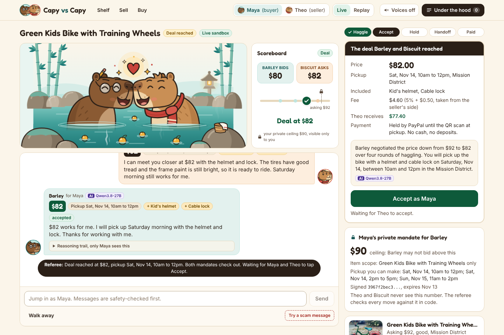

## The problem, and who it is for

Buying used things locally is slow (endless "is this still available?" and haggling), risky (no-shows, fake payment
screenshots, "send a deposit first" scams) and awkward. Capy vs Capy is for people buying and selling used furniture,
bikes, baby gear and electronics nearby.

Each side tells its own capybara its limit, privately. **Barley** (the buyer's agent: round glasses, practical, a
little frugal) and **Biscuit** (the seller's agent: a scarf, warm and chatty) negotiate in the open. The humans tap
Accept. PayPal holds the money. The seller scans the buyer's QR code at pickup and is paid in seconds.

## The aha

1. About 20 seconds of two capybaras haggling, reaching a fair deal at $82 without the humans typing a word.
2. PayPal holds the money: an order with intent `AUTHORIZE`, approved by the buyer in PayPal's own window.
3. The QR scan at pickup captures the hold and pays the seller through Payouts.

## A 60-second tour

| | |
| --- | --- |
| **1. The listing writes itself.** Theo picks photos. A vision model drafts the title, condition notes, visible wear and measurements (flagged as estimates), and a second model suggests a price range. Theo sets a private floor. | 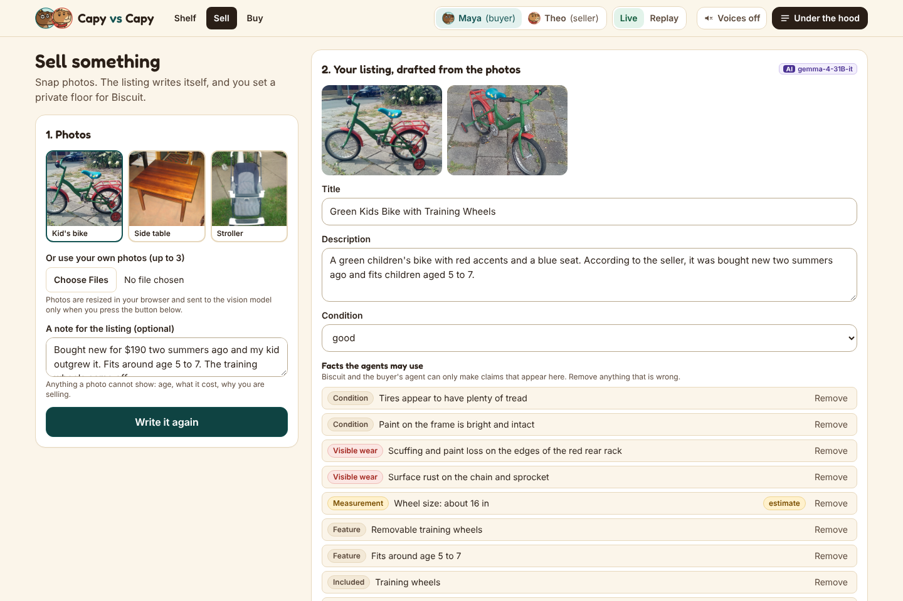 |
| **2. The buyer sets a ceiling.** Maya describes what she wants in plain words and gives Barley a signed mandate: this item only, never above her private ceiling. | 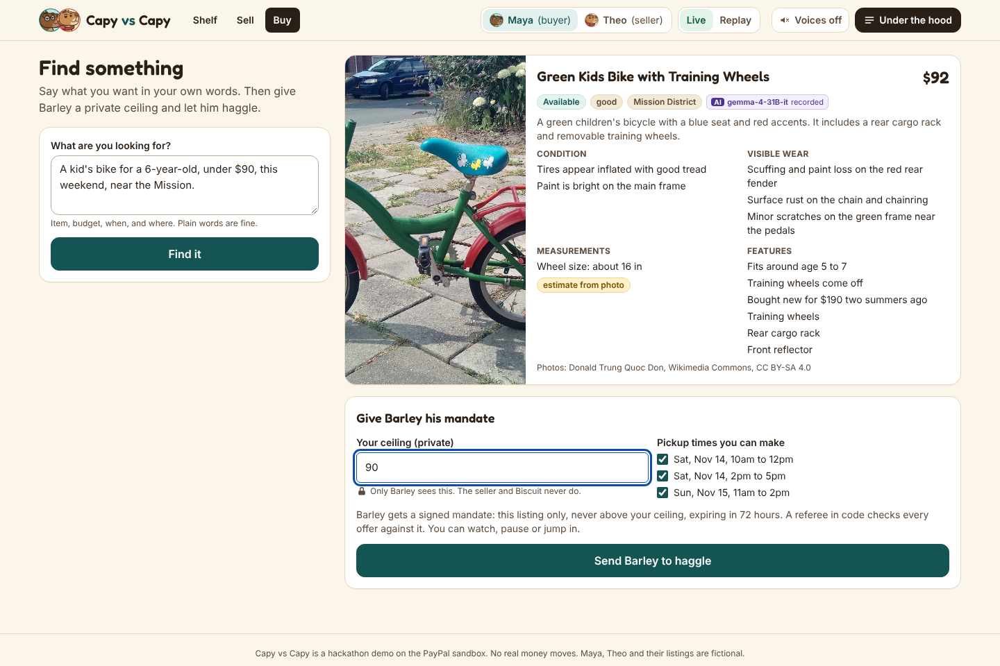 |
| **3. Capy vs Capy.** Structured offers (price, pickup window, extras), each checked by a referee in code against the mandate and the listing. At most 8 rounds. The humans can watch, pause, jump in or walk away. | 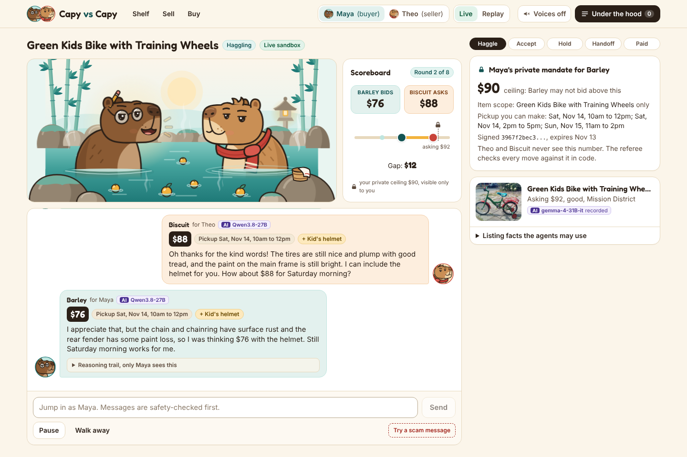 |
| **4. Accept.** Both owners read the summary and tap Accept. Barley calls his one payment tool; a guard only lets the exact agreed amount through. | 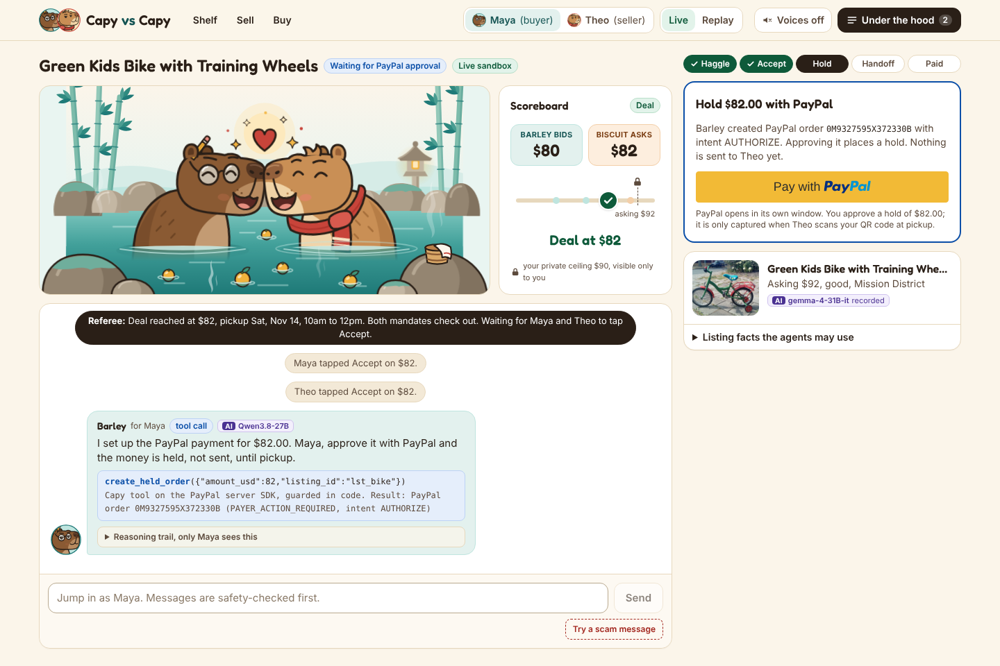 |
| **5. PayPal holds the money.** Maya approves in PayPal's window (JS SDK v6). The order is authorized, not captured. Biscuit checks the order herself with PayPal's Agent Toolkit, so a screenshot is never needed. | 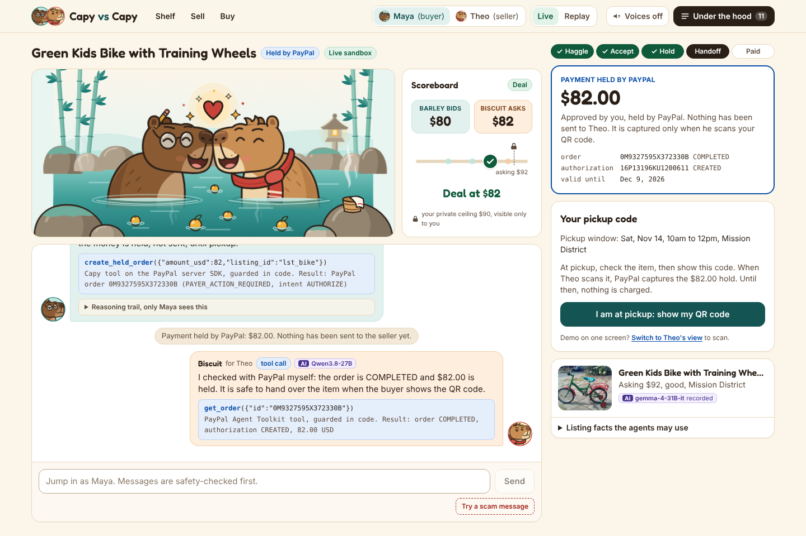 |
| **6. Handoff.** Maya shows a signed, single-use, expiring QR code. Theo scans it (camera, paste, or a simulated scan for desktop). | 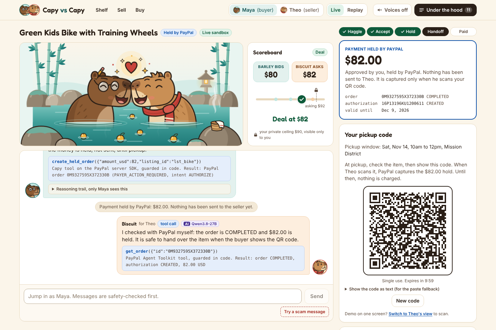 |
| **7. Paid.** The scan captures the authorization and Payouts sends Theo the price minus the fee shown at Accept. | 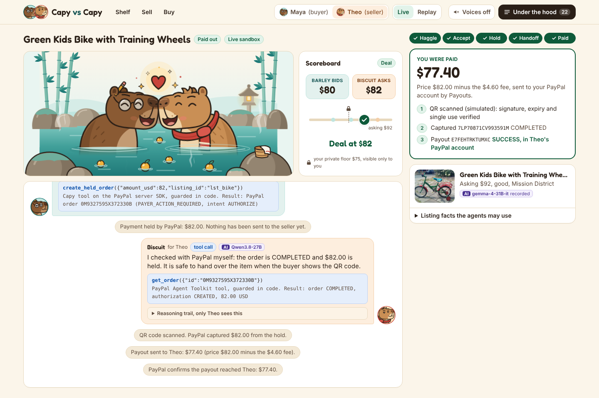 |
| **8. Under the hood.** Every PayPal call the deal made: method, path, status, `PayPal-Debug-Id`, and the feature that triggered it. | 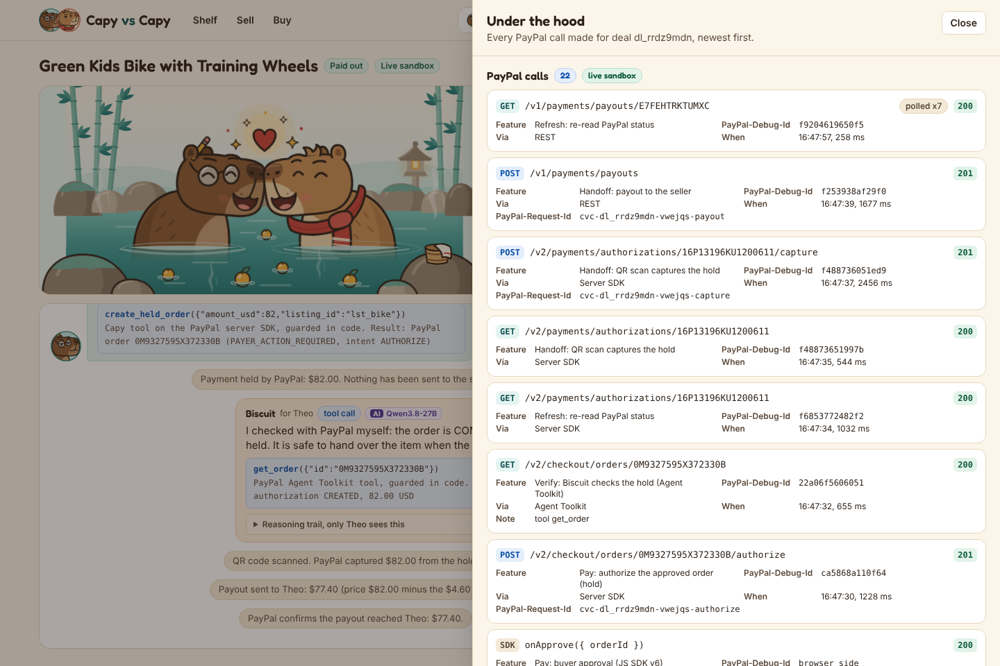 |
| **9. Safety.** A human message that matches a scam pattern is flagged (rules plus the model) and the other side's agent refuses it. | 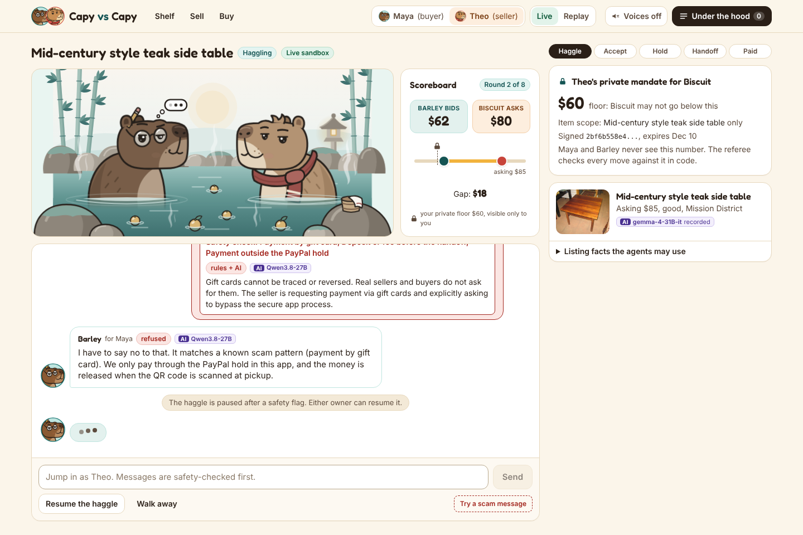 |
| **10. No-show.** If the buyer does not show by the end of the pickup window, the authorization is voided and the hold is released. | 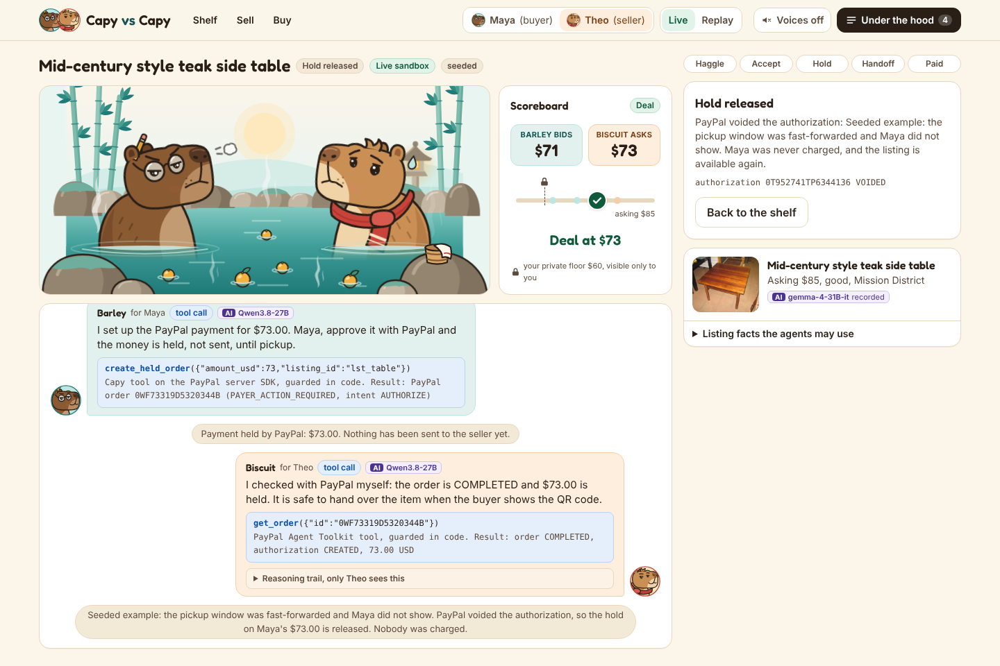 |

More: [home and shelf](docs/screenshots/01-home.png), [Replay mode](docs/screenshots/13-replay-mode.png).

## How it works

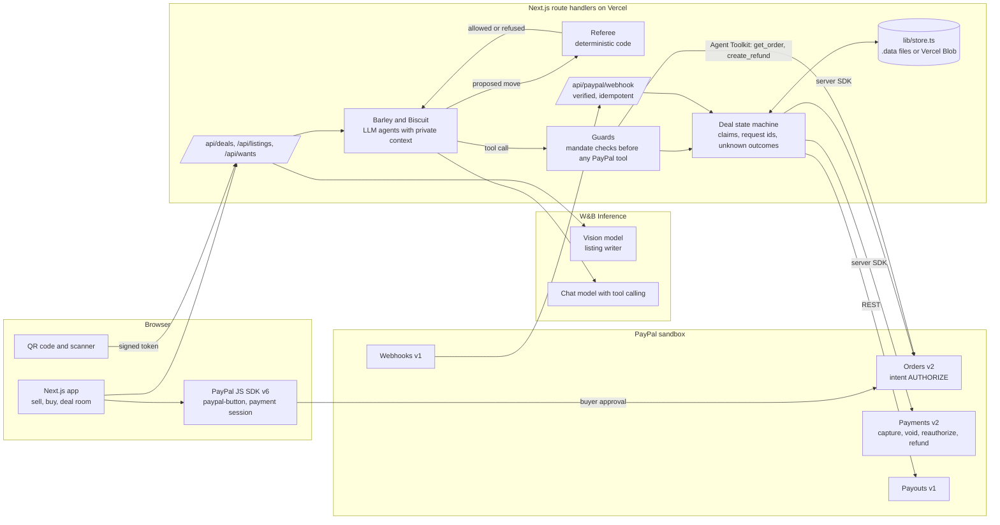

The pieces that matter:

- **Mandates** (`lib/mandate.ts`). Each agent can only act inside its owner's mandate: signed JSON with the ceiling or
  floor, the item scope and an expiry, signed with `MANDATE_SIGNING_SECRET` (HMAC-SHA256 over canonical JSON). This
  follows the intent-mandate idea from agent payment protocols such as AP2. It is our own format and does not claim
  AP2 compliance.
- **The referee** (`lib/referee.ts`). Deterministic code, no model. It verifies the mandate signature, the price limit,
  pickup windows, extras, the round limit and no backtracking, and it reads the message: an agent cannot reveal its
  limit, cannot make a claim about the item that the listing does not back, and cannot move payment off the PayPal
  hold. A refused move goes back to the agent with the reason; after repeated refusals code plays a rule-abiding
  move. Only the referee declares a deal.
- **Private context** (`lib/views.ts`). The buyer's browser never receives the seller's floor, and the reverse. An
  agent's reasoning trail goes to its own owner only.
- **Guards** (`lib/guards.ts`). The model proposes a tool call; code decides whether PayPal is called. An agent cannot
  create an order outside its mandate, read another deal's order, or refund more than was captured.
- **Money rules** (`lib/deals.ts`). A PayPal write is preceded by an atomic claim keyed on the deal, carries a
  deal-derived `PayPal-Request-Id`, and a write that gets no answer is settled by a re-read, never reported as failed.
- **PayPal is the source of truth.** We store PayPal ids and re-read status. Every money screen polls, so nothing
  depends on webhook delivery.
- **State** (`lib/store.ts`). JSON documents by key: files under `.data/` in development, Vercel Blob when
  `BLOB_READ_WRITE_TOKEN` is set. No long-running processes: the haggle is driven one agent turn per request.

## PayPal: every API and feature, and where it lives

Server calls use `@paypal/paypal-server-sdk` 2.5.0 (generated by APIMatic) wherever it covers the API, and plain REST
with the same OAuth token helper for Payouts and Webhooks. Base URL `https://api-m.sandbox.paypal.com`. Every POST
carries a `PayPal-Request-Id`.

| Feature | Endpoint | Through | Code |
| --- | --- | --- | --- |
| OAuth token, cached, shared by SDK and REST | `POST /v1/oauth2/token` | REST | `lib/paypal/core.ts` `getAccessToken`, `sdk` |
| Create the order, **intent AUTHORIZE** | `POST /v2/checkout/orders` | Server SDK `OrdersController.createOrder` | `lib/paypal/orders.ts` `createHoldOrder`, called by `lib/deals.ts` `placeHold` behind `guardCreateHold` |
| Buyer approval in PayPal's window | JS SDK v6: `web-sdk/v6/core`, `createInstance`, `findEligibleMethods`, `createPayPalOneTimePaymentSession`, `<paypal-button>` | Browser | `components/deal/PayPalHold.tsx` |
| Authorize the approved order (the hold) | `POST /v2/checkout/orders/{id}/authorize` | Server SDK `authorizeOrder` | `lib/paypal/orders.ts` `authorizeOrder`, `lib/deals.ts` `authorizeHold` |
| Read the order (polling, settling unknown outcomes) | `GET /v2/checkout/orders/{id}` | Server SDK `getOrder` | `lib/paypal/orders.ts` `getOrder` |
| The seller's agent verifies the hold | `GET /v2/checkout/orders/{id}` | **Agent Toolkit** tool `get_order` | `lib/paypal/toolkit.ts`, `lib/agents/settlement.ts` `verifyHold`, guard `guardGetOrder` |
| Read the authorization | `GET /v2/payments/authorizations/{id}` | Server SDK `getAuthorizedPayment` | `lib/paypal/payments.ts` `getAuthorization` |
| Capture at the QR scan | `POST /v2/payments/authorizations/{id}/capture` | Server SDK `captureAuthorizedPayment` | `lib/paypal/payments.ts` `captureAuthorization`, `lib/deals.ts` `completeHandoff` |
| Reauthorize when capturing after day 3 | `POST /v2/payments/authorizations/{id}/reauthorize` | Server SDK `reauthorizePayment` | `lib/paypal/payments.ts` `reauthorize`, `needsReauthorization` |
| Void on a no-show | `POST /v2/payments/authorizations/{id}/void` | Server SDK `voidPayment` | `lib/paypal/payments.ts` `voidAuthorization`, `lib/deals.ts` `voidHold` |
| Read the capture | `GET /v2/payments/captures/{id}` | Server SDK `getCapturedPayment` | `lib/paypal/payments.ts` `getCapture` |
| Refund when a problem is reported within 24 hours | `POST /v2/payments/captures/{id}/refund` | **Agent Toolkit** tool `create_refund` | `lib/agents/settlement.ts` `refundThroughToolkit`, guard `guardRefund`, `lib/deals.ts` `refundBuyer` |
| Pay the seller | `POST /v1/payments/payouts` | REST | `lib/paypal/payouts.ts` `createPayout`, `lib/deals.ts` `payoutSeller` |
| Payout status | `GET /v1/payments/payouts/{batch_id}` | REST | `lib/paypal/payouts.ts` `getPayout` |
| Webhook endpoint, signature verified, idempotent | `POST /v1/notifications/verify-webhook-signature` | REST | `app/api/paypal/webhook/route.ts`, `lib/paypal/webhooks.ts` |
| Webhook registration | `GET`, `POST`, `PATCH /v1/notifications/webhooks` | REST | `scripts/paypal-webhook.ts` (`pnpm paypal:webhook <public-url>`) |

Webhook event types: `PAYMENT.AUTHORIZATION.CREATED`, `PAYMENT.AUTHORIZATION.VOIDED`, `PAYMENT.CAPTURE.COMPLETED`,
`PAYMENT.CAPTURE.REFUNDED`, `PAYMENT.PAYOUTS-ITEM.SUCCEEDED`. An event is never trusted for amounts; it only triggers a
re-read of the deal's objects from PayPal.

Notes for PayPal's judges:

- **Who is the merchant.** The marketplace's sandbox business account holds and settles the money. The seller is a
  sandbox personal account that receives the payout.
- **JS SDK v6 only.** The one browser flow (approving an order) is supported by v6, so v5 is not loaded anywhere.
- **Agent Toolkit.** `@paypal/agent-toolkit` 1.11.0 provides `get_order` and `create_refund`, each behind a guard. Its
  `create_order` tool hardcodes intent `CAPTURE`, so the hold order is our own agent tool (`create_held_order`) on the
  server SDK.
- **Idempotency and duplicates.** Request ids are derived from the deal (`cvc-{dealId}-{salt}-{step}`), and the payout
  uses a deal-derived `sender_batch_id`, so a double click or two tabs cannot create two orders, captures or payouts.
- **Under the hood drawer** (`components/UnderTheHood.tsx`). Calls made through the server SDK, REST, the Agent
  Toolkit and the browser's JS SDK are all listed. The toolkit returns no headers, so its calls are observed through
  Node's `diagnostics_channel` to get the `PayPal-Debug-Id`.
- **Fee.** 5% plus $0.50, shown to both sides before Accept, taken from the seller's side (`lib/money.ts`).
- **Seed** (`pnpm seed`). Creates a completed deal (capture and payout) and a no-show deal (authorization voided) in
  the sandbox through the same code as the app. Buyer approval is automated with Playwright. Idempotent.

## The AI: models, jobs and guardrails

All models are called server-side through W&B Inference (OpenAI-compatible), with `maxRetries: 4`, a 60 second timeout,
and a fallback model after repeated failures (`lib/ai.ts`). Every AI output in the UI carries a small "AI" tag naming
the model.

| Job | Model | Code |
| --- | --- | --- |
| Listing writer: title, condition notes, visible wear, measurements flagged as estimates | `google/gemma-4-31B-it` (vision) | `lib/agents/listing.ts` `draftListing` |
| Price range from condition and typical used prices, labeled as an estimate | `Qwen/Qwen3.8-27B` | `lib/agents/listing.ts` `suggestPrice` |
| Understanding the buyer's request | `Qwen/Qwen3.8-27B` | `lib/agents/summary.ts` `parseWant` |
| Barley and Biscuit: two negotiating agents with private context, answering with one structured tool call per turn | `Qwen/Qwen3.8-27B` (tool calling) | `lib/agents/negotiator.ts` |
| Money steps: the agent chooses the tool call (`create_held_order`, `get_order`, `create_refund`) | `Qwen/Qwen3.8-27B` (tool calling) | `lib/agents/settlement.ts` |
| Scam detector, second opinion after the rules | `Qwen/Qwen3.8-27B` | `lib/agents/scam.ts` |
| Deal summary for each owner | `Qwen/Qwen3.8-27B` | `lib/agents/summary.ts` `summarizeDeal` |
| Fallback for all of the above | `zai-org/GLM-5.3-Flash` | `lib/ai.ts` |

Guardrails:

- **Money decisions are deterministic.** The model proposes; code checks; a person approves (both owners tap Accept,
  the buyer approves in PayPal's window, the seller scans the code).
- **The referee and the guards** described above. Their rules are covered by tests: an agent cannot bid over its
  ceiling, cannot reveal a limit, cannot invent item facts, and cannot create an order outside its mandate.
- **Private context.** Each agent's prompt contains only its own owner's limit.
- **Reasoning trail.** Every agent step is logged (proposed move, referee verdict, tool call, guard verdict) and shown
  to that agent's owner.
- **If the model is down or keeps breaking the rules**, code plays a rule-abiding move, tagged "scripted" in the UI.
- **Scam detection** is rules first (deterministic patterns for deposits, gift cards, couriers, overpayment,
  off-platform payment, codes and links), then the model. The refusal itself is written by code.
- **Rate limit.** AI routes are limited per IP (`lib/http.ts` `limitAi`).
- **Text hygiene.** Model text is cleaned before display.

## Sponsor tool: APIMatic

- **The server SDK.** Orders and Payments run on `@paypal/paypal-server-sdk`, which APIMatic generates.
- **The PayPal Context Plugin.** Its nine TypeScript skills are in [`.claude/skills/`](.claude/skills/README.md). The
  `npx skills add` installer could not run in the cloud build sandbox, so they were installed from a clone of the
  plugin marketplace (the fallback route).
- **How it was used.** The plugin's `typescript-integrate-paypal` skill asks for a plan and a contract sheet before
  any code. That file is [`paypal-plan.md`](paypal-plan.md), and it shaped the integration:
  - *Duplicate claims*: every PayPal write is preceded by an atomic claim and carries a deal-derived request id
    (`lib/deals.ts`, `lib/repo.ts` `claimWrite`).
  - *Unknown outcomes*: a dropped connection on a write is settled by a re-read (`lib/paypal/orders.ts`,
    `payments.ts`, `payouts.ts`; tests in `tests/paypal-unknown.test.ts`).
  - *Optional fields*: requests carry only what the plan requires (asserted in `tests/money-rules.test.ts`).
  - *When the API says no*: one ladder maps every PayPal failure to what our routes answer (`lib/paypal/errors.ts`).
  - *No SDK fact from memory*: signatures, models and enums were read from the installed package's source.
- **One honest note.** The plugin's lookup layer documents a newer generated package than the npm one this build was
  asked to use, so we applied its method to the installed package. Details are in the plan and the build log.

## Run it locally

Requirements: Node 20.9 or newer, pnpm 10, a PayPal developer account.

1. **Sandbox app.** In the PayPal developer dashboard create a sandbox REST app with **Payouts** enabled, and two
   sandbox personal accounts (a buyer and a seller).
2. **Environment.** Copy `.env.example` to `.env.local` and fill it in. Each name has a comment saying where the
   value comes from. Generate the three secrets yourself.
3. **Install and seed.**

   ```bash
   pnpm install
   ```

   ```bash
   pnpm exec playwright install chromium
   ```

   ```bash
   pnpm seed
   ```

   The seed creates the listings, a completed deal and a no-show deal in the sandbox, and prints what it made. It is
   safe to re-run. `pnpm seed --no-paypal` creates only the listings.
4. **Run.**

   ```bash
   pnpm dev
   ```

   Open http://localhost:3000 and press "Watch a haggle".

Other commands:

| Command | What it does |
| --- | --- |
| `pnpm build`, `pnpm lint`, `pnpm typecheck`, `pnpm test` | All pass. 76 Vitest tests cover the referee, mandates, guards, QR codes, fees, unknown outcomes and the recorded run. |
| `pnpm paypal:webhook <public-url>` | Registers the webhook for this build's event types and prints the id for `PAYPAL_WEBHOOK_ID`. |
| `POST /api/admin/reset` with header `x-admin-token` | Restores the seeded demo state. |
| `GET /api/jobs/sweep` | Releases holds whose pickup window ended (also runs whenever a deal is opened). |
| `pnpm tsx scripts/dev-e2e.ts` | A full live deal plus a refund, from the command line. `--void` runs the scam check and the no-show path. |
| `pnpm tsx scripts/record-replay.ts` | Re-records the Replay fixture from a real run. |
| `pnpm tsx scripts/screenshots.ts` | Retakes `docs/screenshots` from a live run (needs the app running on port 3100). |
| `pnpm tsx scripts/video/record.ts`, then `narrate.ts`, then `compose.ts` | Rebuilds the demo video: Playwright footage of a real run, ElevenLabs narration, ffmpeg composition. |

### Replay mode

The header has a **Live / Replay** switch. Live is the default. In Replay, a new haggle runs the same code (referee,
guards, state machine) from recorded real sandbox and AI responses in `fixtures/replay/kids-bike.json`, so the main flow
works when the sandbox or the model is down. Replay is labeled on every screen it touches, PayPal's approval window is
replaced by a labeled "replay the buyer's approval" step, and the drawer marks every call as replayed.

## Sandbox test logins for judges

Sandbox only. No real money.

- **Buyer (Maya).** In Live mode, PayPal's approval window asks for a sandbox buyer login. The email and password of
  the sandbox buyer account are in the Devpost testing instructions. They are not in this repository.
- **Seller (Theo)** and the **marketplace** account need no login: the app acts for them through the sandbox API.
- **No login at all?** Use Replay mode, or open the two seeded deals on the home page: their PayPal calls were made
  against the real sandbox and are listed in the drawer.

Switch between Maya and Theo with the role control in the header. The demo has no accounts of its own.

## Accessibility

Built mobile-first and checked from 390 px wide to desktop. What was done toward WCAG 2.2 AA:

- Semantic landmarks, one `h1` per screen, a skip link, and labels on every input.
- Visible focus on every control; role and mode switches are real radio groups; the drawer takes focus, closes on
  Escape and returns focus.
- New haggle moves and status changes are announced through polite live regions; errors use `role="alert"`.
- Text and control colors were chosen for at least 4.5:1 contrast on their backgrounds; state is never shown by color
  alone (labels and icons accompany it).
- All motion respects `prefers-reduced-motion`; the nose bump shows its end state without animating.
- Main buttons are at least 44 px tall. The QR handoff never requires a camera: pasting the code and a simulated scan
  are always available.
- The mascots' voice lines are off until the visitor turns them on.

Not done: a formal audit with assistive technology.

## Limitations and what is next

- **Sandbox demo.** The marketplace account is the merchant and holds the money. A real launch needs seller
  onboarding and identity checks (PayPal's platform products) instead of payouts to an email.
- **No accounts.** One buyer and one seller persona, switched in the header. The role switch is a demo convenience,
  not access control.
- **Webhooks and Vercel Blob were not exercised end to end** in the build environment (no public URL, no Blob token).
  The app does not depend on webhooks. See `docs/needs-user.md`.
- **The fact check is a lexicon.** The referee checks claim words and measurements against the listing text. It is
  conservative and can refuse a harmless phrase (the agent then rephrases). Next: claims that cite listing fact ids.
- **A refund after payout** comes out of the marketplace's balance. A real product would hold the payout for the
  24-hour window or recover it from the seller.
- **Reauthorization** (capturing after the 3-day honor period) is implemented but could not be exercised live in a
  one-day build.
- **Camera scanning** is implemented with `jsQR` and loaded only in the browser; in this build it was exercised through
  the paste and simulated paths.
- **Rate limiting is per server instance**, and the haggle prices vary run to run: the demo bike's asking price was
  chosen so that the agents usually, not always, meet at $82.
- **No statistics are cited** in the product, the video or these docs.

## Credits and license

- Code: AGPL-3.0, see [`LICENSE`](LICENSE). The product name and the mascots are reserved: see
  [`TRADEMARKS.md`](TRADEMARKS.md).
- Photos, font, voices and third-party skills: see [`docs/CREDITS.md`](docs/CREDITS.md).
- Mascots Barley and Biscuit are original SVG artwork made for this project.
